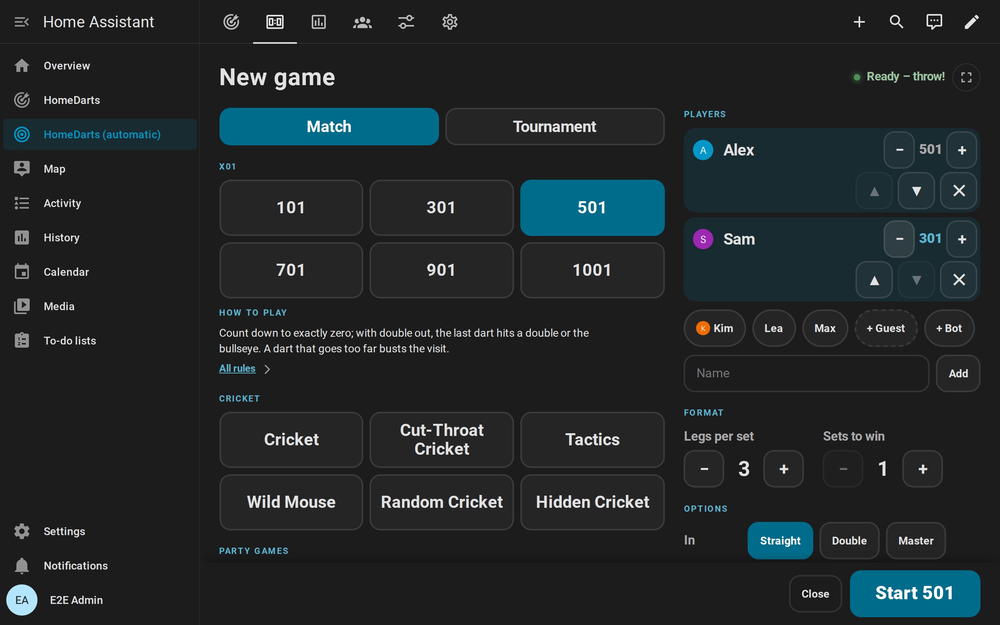
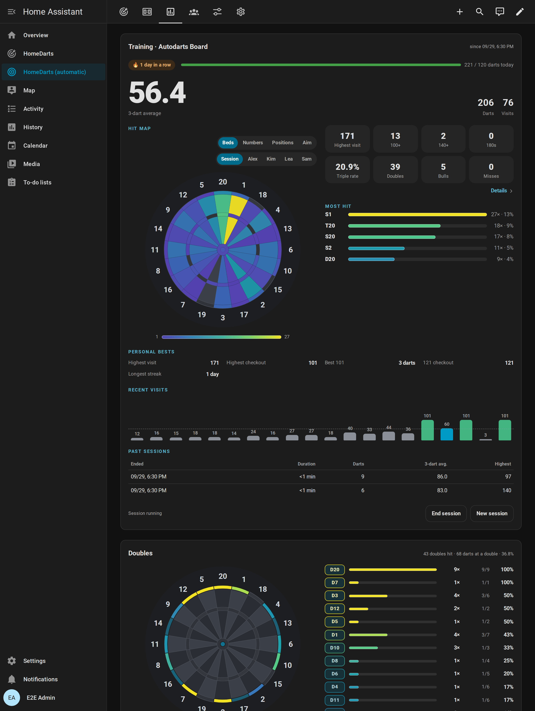

# De zéro au tableau des scores

[← Documentation](README.md) · [English](getting-started.md)

Vous jouez sur une cible Autodarts et n'avez jamais utilisé Home Assistant ? Ce guide vous mène de rien jusqu'au tableau des scores sur une tablette à côté de votre cible. Home Assistant, HACS et l'intégration sont gratuits. Comptez environ une heure ; l'essentiel sert à installer Home Assistant lui-même.

**Sur cette page :** [Ce qu'il vous faut](#ce-quil-vous-faut) · [1. Installer Home Assistant](#1-installer-home-assistant) · [2. Installer HACS](#2-installer-hacs) · [3. Installer l'intégration](#3-installer-lintégration) · [4. Ajouter votre cible](#4-ajouter-votre-cible) · [5. Créer le tableau de bord](#5-créer-le-tableau-de-bord) · [6. Placer le tableau des scores à côté de la cible](#6-placer-le-tableau-des-scores-à-côté-de-la-cible) · [7. Jouer votre première partie](#7-jouer-votre-première-partie) · [Et ensuite](#et-ensuite) · [Si quelque chose ne marche pas](#si-quelque-chose-ne-marche-pas)

## Ce qu'il vous faut

- **Votre cible Autodarts,** installée et en état de marche. [Appareils pris en charge](index.fr.md#appareils-pris-en-charge) liste les installations testées. Pas d'Autodarts ? [Jouez sans Autodarts](without-autodarts.md) sur n'importe quelle cible, en saisissant vos fléchettes sur un pavé numérique.
- **Un appareil pour Home Assistant** qui reste allumé, dans le même réseau que la cible : un Raspberry Pi 4 ou 5, un mini PC ou une machine virtuelle sur un ordinateur toujours allumé. Home Assistant vend aussi des appareils prêts à l'emploi. Prenez un appareil à part : le PC de la cible a besoin de sa puissance pour la détection.
- **Un compte GitHub gratuit,** que HACS utilise pour télécharger les intégrations.
- **Un écran pour le tableau des scores,** si vous en voulez un : une tablette, une télévision avec un navigateur ou un vieux téléphone.

## 1. Installer Home Assistant

Suivez le [guide d'installation](https://www.home-assistant.io/installation/) officiel pour votre appareil ; il montre chaque étape en images. Sur un Raspberry Pi, choisissez **Home Assistant OS** ([guide pour le Raspberry Pi](https://www.home-assistant.io/installation/raspberrypi)).

À la fin, ouvrez Home Assistant dans un navigateur, en général à l'adresse `http://homeassistant.local:8123`, et créez votre compte. Le [guide de première configuration](https://www.home-assistant.io/getting-started/onboarding/) explique les questions.

## 2. Installer HACS

HACS est la boutique des intégrations et des cartes de la communauté, comme celle-ci. Suivez le guide officiel pour [télécharger HACS](https://www.hacs.xyz/docs/use/download/download/) et le [configurer](https://www.hacs.xyz/docs/use/configuration/basic/) avec votre compte GitHub. Ensuite, **HACS** apparaît dans la barre latérale de Home Assistant.

## 3. Installer l'intégration

1. Choisissez le bouton ci-dessus et confirmez l'adresse de votre Home Assistant. HACS ouvre cette intégration. Sans le bouton : ouvrez **HACS**, recherchez **HomeDarts** et ouvrez-la.
2. Choisissez **Télécharger**.
3. Redémarrez Home Assistant : **Paramètres → Système**, le bouton d'alimentation en haut à droite, **Redémarrer Home Assistant**.

## 4. Ajouter votre cible

Avec Board Manager 2, Home Assistant trouve en général la cible tout seul : **Paramètres → Appareils et services** affiche **Cible Autodarts détectée** sous *Découverts*. Choisissez **Ajouter** et confirmez.

Sinon, choisissez le bouton ci-dessus, puis **Rechercher des cibles sur ce réseau**, ou **Saisir l'adresse de la cible** avec l'adresse IP du PC de la cible. Aucun compte Autodarts n'est nécessaire.

Le [guide d'installation](installation.fr.md#ajouter-votre-cible) explique chaque façon en détail. Sans Autodarts, choisissez **Cible sans Autodarts : saisir soi-même chaque fléchette** et donnez un nom à la cible ; [Play without Autodarts](without-autodarts.md) montre la suite.

## 5. Créer le tableau de bord

Allez dans **Paramètres → Tableaux de bord → Ajouter un tableau de bord → HomeDarts**. Un clic crée un tableau de bord complet pour votre cible, avec des vues pour la partie en direct, le tableau des scores, l'entraînement, les joueurs et la cible. Il se met à jour tout seul quand vous ajoutez une cible ou qu'une version suivante apporte de nouvelles vues.

## 6. Placer le tableau des scores à côté de la cible

1. Sur la tablette, ouvrez Home Assistant dans le navigateur ou dans l'[application Home Assistant](https://companion.home-assistant.io/) et connectez-vous. Un utilisateur à part, sans droits d'administrateur, empêche l'écran de modifier vos réglages.
2. Ouvrez le tableau de bord HomeDarts et sa vue *Tableau des scores*.
3. Mettez le tableau des scores en plein écran et gardez l'écran allumé pendant que la tablette se recharge.

Le [guide du tableau des scores](scoreboard.md#set-up-the-screen) donne les détails et les options, comme l'annonceur.

## 7. Jouer votre première partie

Touchez **Nouvelle partie** sur le tableau des scores. Choisissez 501, ajoutez-vous, ajoutez le **bot** avec **+ Bot** si vous jouez seul, puis touchez **Démarrer 501**. Lancez vos fléchettes : le tableau des scores compte, affiche votre combinaison de finish et passe la main après chaque volée.

Si la cible lit mal une fléchette, touchez-la dans la volée et corrigez-la. Le [guide des jeux](games.md#start-a-game) présente chaque jeu et les autres façons d'en lancer un.

## Et ensuite

- **Lumière et son :** les [blueprints](automations.md#blueprints) font clignoter vos lampes sur un 180, annoncent les scores ou prennent une photo d'un beau coup. Ils sont livrés avec l'intégration et vous attendent sur la page des blueprints de Home Assistant.
- **Vos progrès :** les records personnels, une carte des touches de vos fléchettes, les tendances et les succès sont dans le [guide des statistiques](statistics.md).
- **Des amis à la maison :** les équipes, les handicaps et les tournois jusqu'à 32 joueurs sont dans le [guide des jeux](games.md).

## Si quelque chose ne marche pas

- Le [guide de dépannage](troubleshooting.md) explique chaque message de la configuration et chaque avis de réparation.
- Posez votre question dans les [GitHub Discussions](https://github.com/Dennis-Otto/homedarts-for-autodarts/discussions/categories/q-a). Les questions y reçoivent leur réponse, et chaque réponse aide aussi le joueur suivant. Les questions en anglais ou en allemand reçoivent la réponse la plus rapide.
- Si votre installation ne figure pas dans la liste des [appareils pris en charge](index.fr.md#appareils-pris-en-charge), un [rapport de compatibilité](https://github.com/Dennis-Otto/homedarts-for-autodarts/issues/new?template=board_compatibility.yml) nous aide, que cela fonctionne ou non.
