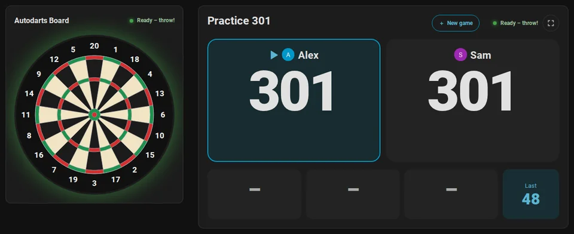
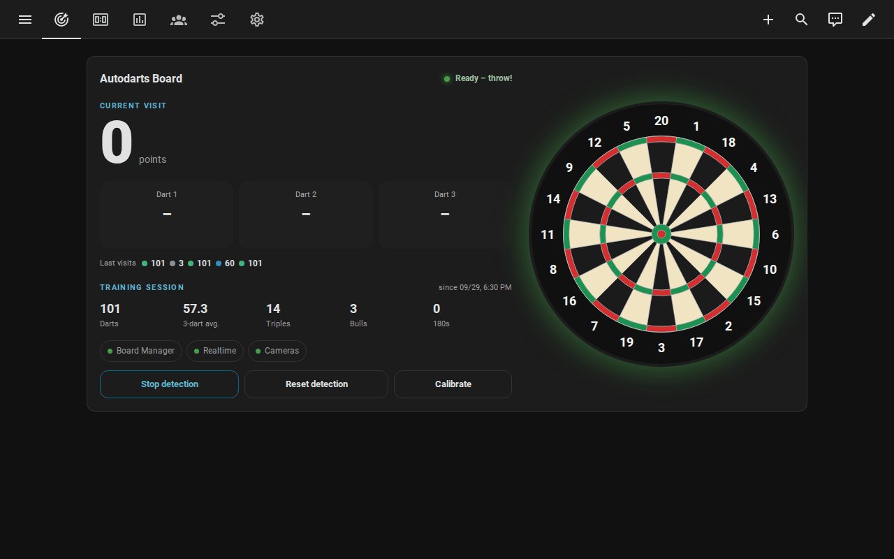
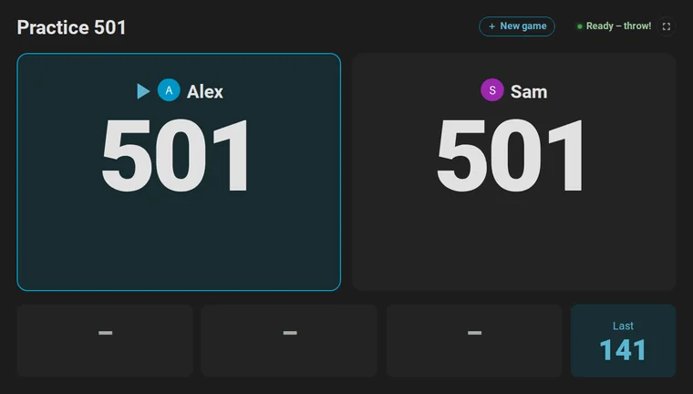
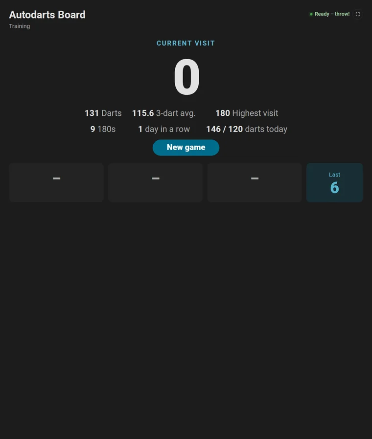
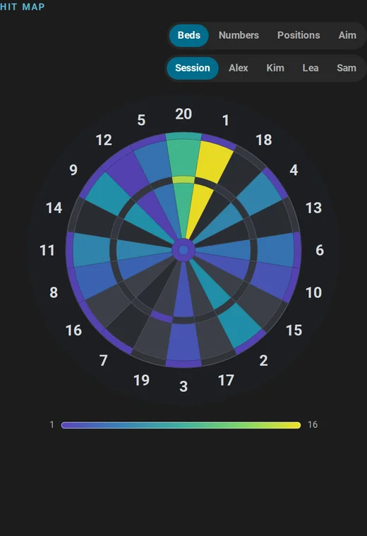
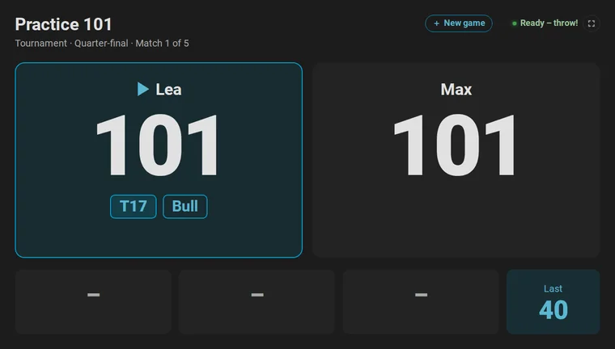
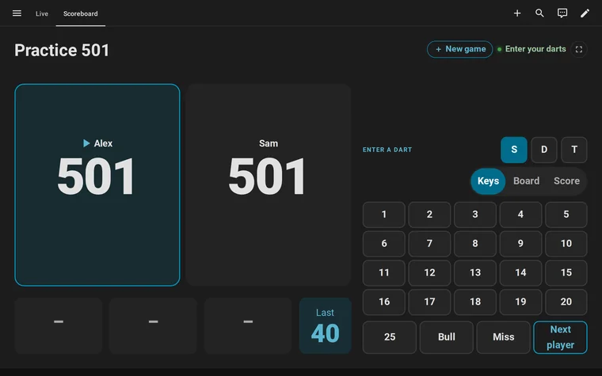

# HomeDarts for Autodarts

{ width="96" align="right" }

**Tu diana Autodarts en directo en Home Assistant: local, en tiempo real y lista para automatizaciones.**

HomeDarts for Autodarts lleva tu diana Autodarts a Home Assistant: un dardo aparece una fracción de segundo después de clavarse, directamente desde el Board Manager de tu red. Cualquier otra diana también sirve, con sus dardos introducidos a mano o enviados por una Granboard. Juega y entrena con ella, pon un marcador junto a la diana, sigue tus estadísticas y deja que tu casa participe. Sin cuenta, sin nube, sin ID de cliente.

HomeDarts for Autodarts es un proyecto no oficial de la comunidad, sin relación con Autodarts. Hasta la versión 1.18 se llamaba Autodarts: [From Autodarts to HomeDarts](new-name.md) explica el nuevo nombre y cómo HomeDarts transfiere tus dianas.

[:material-download: Instalar con HACS](https://my.home-assistant.io/redirect/hacs_repository/?owner=Dennis-Otto&repository=homedarts-for-autodarts&category=integration){ .md-button .md-button--primary } [:material-rocket-launch: Primeros pasos](getting-started.es.md){ .md-button } <a href="demo/index.html?lang=es" class="md-button">:material-play-circle: Probar en directo</a>

<picture>
  <source media="(max-width: 600px)" srcset="images/en/hero-mobile.webp">
  
</picture>

## Qué hace

- { loading=lazy }

    :material-lan-connect:{ .lg .middle } **Local y en tiempo real**

    ---

    Se detecta automáticamente con Board Manager 2; Board Manager 1 también funciona. Nada sale de tu red, salvo que uses la búsqueda de dianas o el puente en línea, y los secretos de la diana nunca se guardan.

    [:octicons-arrow-right-24: How it works](how-it-works.md)

- { loading=lazy }

    :material-bullseye-arrow:{ .lg .middle } **Juegos**

    ---

    X01 de 101 a 1001 con la ruta de cierre después de cada dardo, Cricket, Cut-Throat Cricket, Tactics, Wild Mouse, Random y Hidden Cricket, y nueve juegos de fiesta para hasta ocho jugadores, solo o como partido de hasta cuatro con legs, sets, equipos y hándicaps.

    [:octicons-arrow-right-24: Games and rules](games.md)

- { loading=lazy }

    :material-target:{ .lg .middle } **Entrenamiento**

    ---

    Sesiones de entrenamiento que empiezan con el primer dardo, ocho juegos de entrenamiento desde Around the Clock hasta el JDC Challenge, un objetivo diario, una racha de entrenamiento y récords personales.

    [:octicons-arrow-right-24: Training games](games.md#training-games)

- { loading=lazy }

    :material-monitor-dashboard:{ .lg .middle } **Marcador y tarjetas**

    ---

    Un marcador para una tableta o un televisor, también por Chromecast, legible desde la línea de tiro, con una pantalla de nueva partida, un locutor y un modo de espera. Siete tarjetas del panel y un panel automático, en inglés, alemán, neerlandés, francés y español.

    [:octicons-arrow-right-24: Scoreboard at the board](scoreboard.md) · [Dashboard cards](cards.md)

- { loading=lazy }

    :material-chart-line:{ .lg .middle } **Estadísticas con mapas de calor**

    ---

    Media de 3 dardos, media First 9, porcentaje de cierre y de dobles, un mapa de calor de cada sector o de las posiciones reales de los dardos, y dónde puntúa más cada jugador por dardo. Perfiles de jugador con insignias, tendencias semanales, una clasificación, un informe semanal y un calendario de entrenamiento.

    [:octicons-arrow-right-24: Statistics and players](statistics.md)

- { loading=lazy }

    :material-home-automation:{ .lg .middle } **Automatizaciones y blueprints**

    ---

    Eventos de la diana para cada dardo, tirada, retirada de dardos, bust, leg y partido ganados, y el comienzo y el final de cada partida. Dieciséis blueprints (planos, en Home Assistant): espectáculo de luces, música de entrada, pantalla de puntuación, locutores de dardos y de entrenamiento, fotos destacadas, informes, avisos, rutinas, partidas iniciadas y dardos introducidos por voz, y respuestas de Assist sobre tus dardos.

    [:octicons-arrow-right-24: Automations](automations.md)

- { loading=lazy }

    :material-tournament:{ .lg .middle } **Torneos y un bot**

    ---

    Torneos de tres a 32 jugadores, como todos contra todos con clasificación, eliminación directa, doble eliminación o grupos y eliminación directa, en una diana o en varias a la vez, y un bot del nivel 20 al 120 contra el que jugar X01 y Cricket.

    [:octicons-arrow-right-24: Tournaments](games.md#tournaments) · [The bot](games.md#playing-against-the-bot)

- { loading=lazy }

    :material-microphone:{ .lg .middle } **Voz**

    ---

    Di "Juega 501 para Alex y Sam" a Assist, en español, inglés, alemán, francés o neerlandés, y la partida empieza; después "Alex hace 140" o "Triple 20" introduce los dardos, como en una máquina de dardos, y "¿Cuál es mi media de hoy?" recibe su respuesta de las estadísticas de la diana. Cualquier partida también empieza con una sola acción de una automatización.

    [:octicons-arrow-right-24: Start a game by voice](automations.md#start-a-game-by-voice)

    [:octicons-arrow-right-24: Enter darts by voice](automations.md#enter-darts-by-voice)

    [:octicons-arrow-right-24: Ask Assist about your darts](automations.md#ask-assist-about-your-darts)

## Del dardo a tu casa

Todo ocurre en tu red, en menos de un segundo: el Board Manager nombra el sector, y Home Assistant lo muestra en las tarjetas y se lo pasa a tus automatizaciones.

<picture>
  <source media="(prefers-color-scheme: dark)" srcset="images/en/dart-journey-dark.png">
  
</picture>

[:octicons-arrow-right-24: How it works](how-it-works.md)

## Comparación

Frente a la aplicación de Autodarts con la extensión Tools for Autodarts, darts-caller y darts-wled, y las otras integraciones de Home Assistant para Autodarts:

- **Sin nube:** HomeDarts habla con la interfaz local del Board Manager y no necesita una cuenta de Autodarts.
- **Entidades y eventos en Home Assistant:** un evento para cada dardo, tirada, retirada de dardos, bust, leg y partido, y dieciséis blueprints que hacen algo con ellos desde el principio.
- **Estadísticas en casa:** medias, mapas de calor, perfiles y un año de historial, guardados en Home Assistant.
- **También sin diana Autodarts:** en un teclado numérico o con una Granboard por Bluetooth *(experimental)*.
- **Gratis:** código abierto con licencia MIT, sin versión de pago.

[Coming from another tool](coming-from.md) lo compara todo, con las fuentes, y muestra cómo pasar a HomeDarts *(en inglés)*.

## Guías

- :material-rocket-launch: [**De cero al marcador**](getting-started.es.md): Home Assistant, HACS, la integración y la primera partida, para jugadores de Autodarts que no conocen Home Assistant
- :material-download: [**Instalación y configuración**](installation.es.md): los requisitos, HACS o manualmente, y las formas de añadir una diana
- :material-frequently-asked-questions: [**Preguntas frecuentes**](faq.es.md): la cuenta, los dispositivos, el juego en línea, la privacidad, varias dianas, las pantallas, los idiomas y las actualizaciones

En inglés:

- :material-pencil: [**Play without Autodarts**](without-autodarts.md): cualquier diana, con todos los juegos, el entrenamiento y las estadísticas, los dardos introducidos en un teclado numérico
- :material-bluetooth: [**Granboard over Bluetooth**](granboard.md): los dardos de una Granboard por el Bluetooth de Home Assistant y los proxies de ESPHome *(experimental)*
- :material-swap-horizontal: [**Coming from another tool**](coming-from.md): las otras integraciones, los puentes MQTT, darts-caller, darts-wled y Tools for Autodarts comparados, y cómo pasar a HomeDarts
- :material-rename-box: [**From Autodarts to HomeDarts**](new-name.md): el nuevo nombre desde la versión 2.0, y cómo HomeDarts transfiere tus dianas
- :material-bullseye-arrow: [**Games and rules**](games.md): cada juego de un vistazo, cuatro formas de empezar uno, partidos, equipos, hándicaps, el bull-off y los torneos
- :material-television: [**Scoreboard at the board**](scoreboard.md): una tableta o un televisor junto a la diana, en horizontal y en vertical, la pantalla de nueva partida, el locutor y el modo de espera
- :material-chart-line: [**Statistics and players**](statistics.md): sesiones, récords personales, mapas de calor, dónde apuntar, progreso, perfiles, logros y la clasificación
- :material-home-automation: [**Automations**](automations.md): dieciséis blueprints, sus ajustes, los eventos de la diana y ejemplos listos para usar
- :material-play-network: [**Online matches**](online-matches.md): busts, legs y partidos ganados de los partidos en línea como eventos de la diana, con Tools for Autodarts *(experimental)*

## Referencia

- :material-view-dashboard:{ .lg .middle } [**Dashboard cards**](cards.md)

    ---

    Las siete tarjetas y el panel automático, con cada opción y la accesibilidad.

- :material-format-list-bulleted:{ .lg .middle } [**Entities and events**](entities.md)

    ---

    Cada entidad, evento de la diana, estado, atributo y acción, y qué generación del Board Manager los ofrece.

- :material-cog-transfer:{ .lg .middle } [**How it works**](how-it-works.md)

    ---

    La arquitectura, los intervalos de actualización, el comportamiento de la conexión, el entrenamiento y los récords, los datos guardados y la privacidad.

- :material-lifebuoy:{ .lg .middle } [**Troubleshooting**](troubleshooting.md)

    ---

    Los mensajes de la configuración, las reparaciones, las entidades no disponibles, las acciones que fallan, los diagnósticos y los registros.

- :material-shield-lock:{ .lg .middle } [**Security design**](security.md)

    ---

    Qué se protege, los límites de confianza, las amenazas y las contramedidas.

- :material-book-alphabet:{ .lg .middle } [**Glossary**](glossary.md)

    ---

    Las palabras de los dardos y de esta integración.

Lo que trajo cada versión está en el [registro de cambios](changelog.md), lo que viene después en la [hoja de ruta](roadmap.md). Para vídeos, artículos y publicaciones, el [kit para creadores](creator-kit.md) tiene datos, textos listos para publicar, vídeos e imágenes, de uso libre.

## Dispositivos compatibles

- **Board Manager 2:** Autodarts 2 sin pantalla (headless), probado hasta la versión 2.1.0 y encontrado automáticamente.
- **Board Manager 1:** la aplicación clásica, probada con la versión 1.0.7.
- **Autodarts Desktop** en Linux funciona, según un jugador; Autodarts Desktop en Windows y los dispositivos de Winmau como Autodarts X aún no se han probado.
- **Home Assistant** 2026.8 o posterior.
- **Sin Autodarts:** cualquier diana, con los dardos introducidos en un teclado numérico.

Funciona cualquier hardware en el que se ejecute el Board Manager de Autodarts, porque la integración habla con el Board Manager y no con las cámaras. [Supported devices](README.md#supported-devices) tiene la tabla completa. ¿Tu equipo no aparece? Un [informe de compatibilidad](https://github.com/Dennis-Otto/homedarts-for-autodarts/issues/new?template=board_compatibility.yml) nos ayuda, aunque todo funcione.

## Idiomas

La integración habla español, inglés, alemán, neerlandés y francés: la configuración, las opciones, las entidades y sus estados, las acciones, los mensajes y las reparaciones, las tarjetas con sus editores y el locutor del marcador. Sigue el idioma de Home Assistant; una variante regional como `es-419` cuenta como ese idioma.

Este sitio está en inglés y alemán, y el inicio, el inicio rápido, la instalación y las preguntas frecuentes también en neerlandés, francés y español. Las demás páginas las muestra en inglés. ¿Hablas español? [Ayúdanos a traducir](https://github.com/Dennis-Otto/homedarts-for-autodarts/blob/main/CONTRIBUTING.md#translations): corrige una frase o traduce una página que eches de menos, directamente en GitHub, sin programar.
