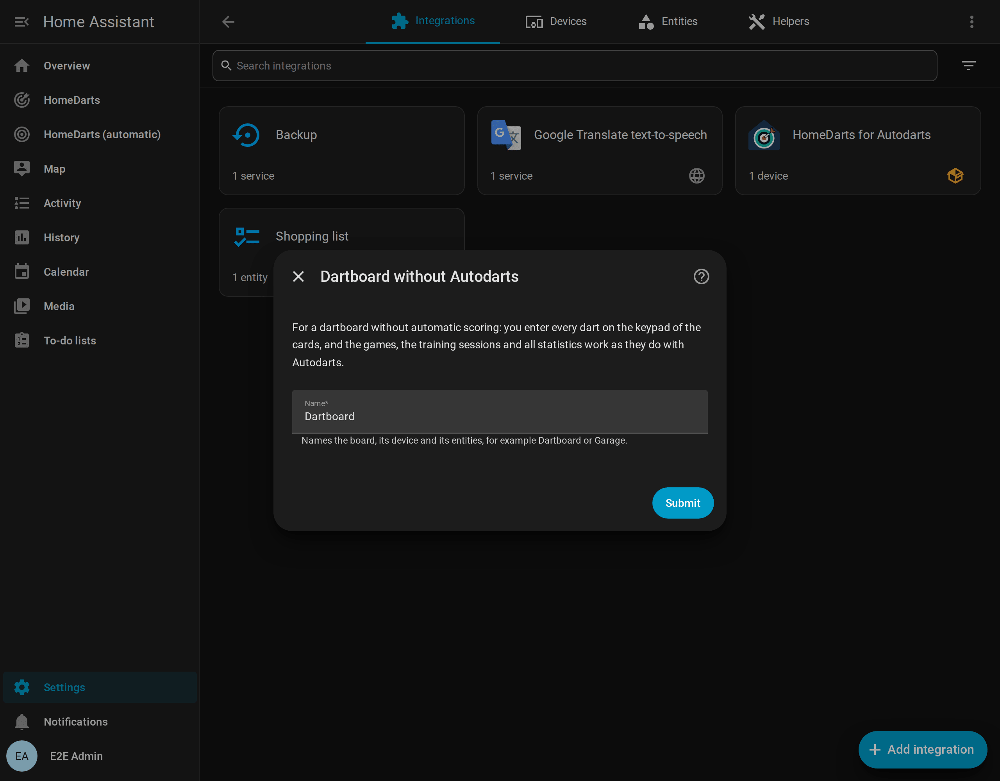

# Installatie en instellen

[← Documentatie](README.md) · [English](installation.md)

Deze pagina beschrijft het installeren en het toevoegen van een bord. Het opnieuw configureren, de overstap naar Board Manager 2, de update vanaf versie 1.x, de overstap vanaf de oorspronkelijke integratie en het verwijderen staan op de [Engelse pagina](installation.md#reconfigure).

## Vereisten

| Vereiste | Details |
| --- | --- |
| Home Assistant | **2026.8** of nieuwer ([waarom 2026.8](decisions/0022-home-assistant-2026-8-as-the-oldest-release.md), in het Engels) |
| Autodarts-bord | Ingesteld en werkend in de Board Manager van Autodarts: **Board Manager 2**, Autodarts 2 zonder scherm (headless, aanbevolen, getest tot 2.1.0), of de klassieke **Board Manager 1**. Volgens een speler werkt ook **Autodarts Desktop** 2.0.2 op Linux. Autodarts Desktop op Windows en de **apparaten van Winmau** zoals Autodarts X of Lens zijn nog niet getest; [laat ons weten](https://github.com/Dennis-Otto/homedarts-for-autodarts/issues/new?template=board_compatibility.yml) hoe het met de jouwe werkt |
| Netwerk | Home Assistant bereikt de bord-pc in het lokale netwerk, standaard op TCP-poort **3180** |
| Zonder Autodarts | Elk dartbord: je voert de darts in op een toetsenblok, zie [Play without Autodarts](without-autodarts.md); dan heb je geen pc bij het bord en geen netwerk naar het bord nodig |

De integratie heeft **geen Autodarts-login, wachtwoord of API-sleutel** nodig. Ze verandert nooit de registratie van je bord bij Autodarts. Ze heeft ook geen koppeling met de cloud van Autodarts: Autodarts geeft geen client-ID's uit aan integraties van derden ([beslissing 0025](decisions/0025-no-cloud-link.md), in het Engels).

## Installeren

### Met HACS (aanbevolen)

1. Selecteer de knop hierboven, of open **HACS** in Home Assistant, zoek naar **HomeDarts** en open de integratie.
2. Selecteer **Download**.
3. Start Home Assistant opnieuw.

HACS toont nieuwe versies als update onder **Instellingen → Updates**. Het updatevenster toont de release notes. HACS installeert het ondertekende releasepakket `homedarts.zip`, hetzelfde bestand als bij een [handmatige installatie](#handmatig).

De integratie hoort sinds 20 oktober 2026 bij de standaardrepository's van HACS ([hacs/default#11306](https://github.com/hacs/default/pull/11306)). Had je haar eerder als aangepaste repository toegevoegd, dan hoef je niets te doen: HACS toont haar niet meer bij de aangepaste repository's en behoudt je installatie en de updates.

Wil je bèta's testen? [Betas for testers](installation.md#betas-for-testers) legt uit hoe HACS ze aanbiedt.

### Handmatig

1. Download `homedarts.zip` van de nieuwste release op [GitHub](https://github.com/Dennis-Otto/homedarts-for-autodarts/releases). Het bevat de bestanden van de integratie, zonder map eromheen.
2. Maak de map `custom_components/homedarts` in je Home Assistant-configuratie en pak het bestand daar uit. Het resultaat is `config/custom_components/homedarts/manifest.json`.
3. Start Home Assistant opnieuw.

De releaseworkflow ondertekent elk pakket: `gh attestation verify homedarts.zip --repo Dennis-Otto/homedarts-for-autodarts` controleert met de GitHub CLI dat het uit deze repository is gebouwd, zie [signed release packages](releases.md#signed-release-packages).

## Je bord toevoegen

Er zijn drie manieren om een Autodarts-bord toe te voegen. Ze eindigen allemaal met hetzelfde, volledig lokale bord. Een vierde voegt een [dartbord zonder Autodarts](#4-een-dartbord-zonder-autodarts) toe.

Welke manier bij je bord past:

<picture>
  <source media="(prefers-color-scheme: dark)" srcset="images/en/add-board-dark.png">
  
</picture>

### 1. Automatisch gevonden (Board Manager 2)

Board Manager 2 meldt zich in het netwerk aan (mDNS, `_autodarts-board._tcp`). Home Assistant toont dan **Autodarts-bord gevonden** onder **Instellingen → Apparaten en diensten → Ontdekt**. Selecteer **Voeg toe** en bevestig. Het venster noemt het adres, de versie van de Board Manager en het aantal camera's.

Krijgt het bord later een nieuw IP-adres, dan werkt de aanmelding het ingestelde adres automatisch bij.

### 2. Borden zoeken in dit netwerk

Kies **Borden zoeken in dit netwerk**. De integratie vraagt de openbare zoekdienst van Autodarts, die ook de Board Manager-app gebruikt, welke borden vanaf je internetverbinding zijn geregistreerd. Kies je bord, en de integratie maakt er lokaal verbinding mee. De vermelding en het apparaat krijgen de naam die het bord bij Autodarts heeft.

> De zoekdienst ziet je openbare IP-adres, zoals elke website. Er wordt niets anders verstuurd. Is de dienst niet bereikbaar of vindt hij geen nieuw bord, dan gaat in plaats daarvan het adresformulier open.

### 3. Het bordadres invoeren

Kies **Bordadres invoeren** en voer het IP-adres of de hostnaam van de bord-pc in, bijvoorbeeld `192.0.2.10` of `autodarts.local`, zonder `http://` en zonder poort. De poort is normaal **3180**.

De integratie leest het ID van het bord uit de Board Manager. Ze weigert adressen die niet bereikbaar zijn of waar nog geen bord is ingesteld.

> **Tip:** geef de bord-pc een vast IP-adres in je router. Met Board Manager 2 houdt de automatische aanmelding het adres sowieso actueel.

### 4. Een dartbord zonder Autodarts

Kies **Dartbord zonder Autodarts: elke dart zelf invoeren** en geef het bord een naam, zoals *Garage*. Je voert de darts in op het toetsenblok van de livekaart en het scorebord, en de spellen, de training en de statistieken werken zoals met Autodarts; [Play without Autodarts](without-autodarts.md) legt alles uit. Je kunt er meerdere hebben, naast Autodarts-borden, en elk kan later [zijn Autodarts-bord krijgen](without-autodarts.md#autodarts-later).

### Na het instellen

Home Assistant maakt één apparaat, genoemd naar je bord, met alle [entiteiten](entities.md). Voor een dashboard met alles ga je naar **Instellingen → Dashboards → Voeg dashboard toe → HomeDarts**, zoals het venster aan het eind van het instellen zegt: het [automatische dashboard](cards.md#automatic-dashboard) bouwt zijn weergaven op uit je borden. Op een eigen dashboard vindt **Voeg kaart toe** de kaarten als je zoekt naar *HomeDarts*; zie de [handleiding van de kaarten](cards.md).

[Van nul tot het scorebord](getting-started.nl.md) gaat verder met het scorebord op een tablet en je eerste spel.
